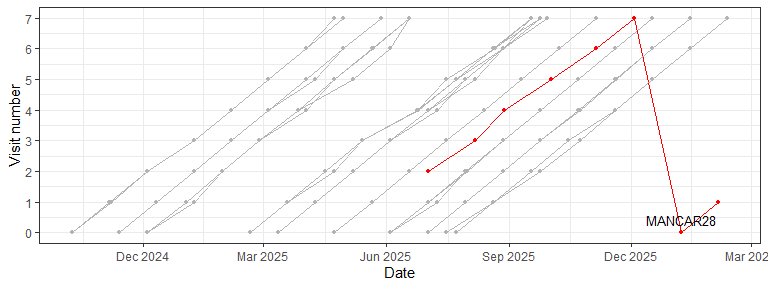
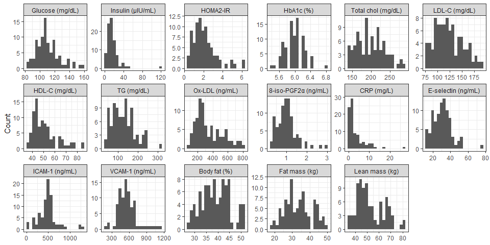
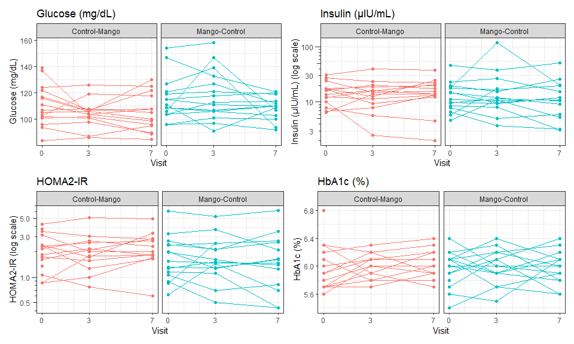
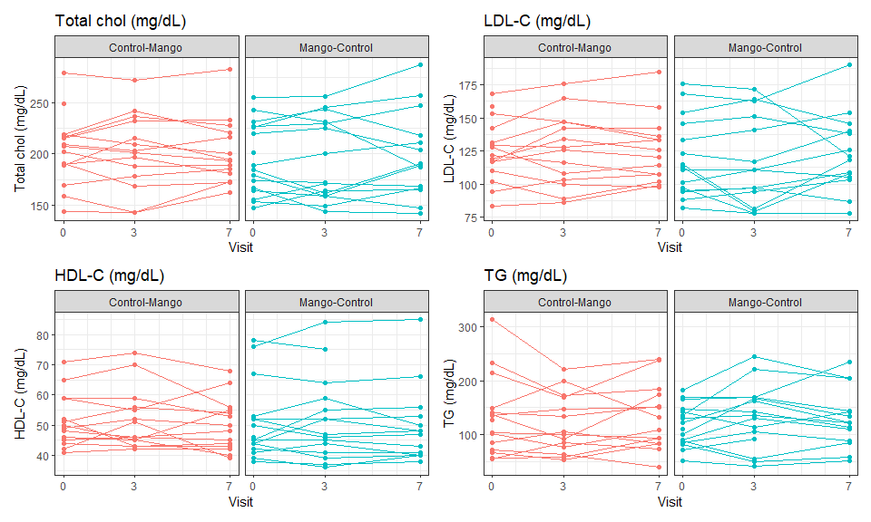
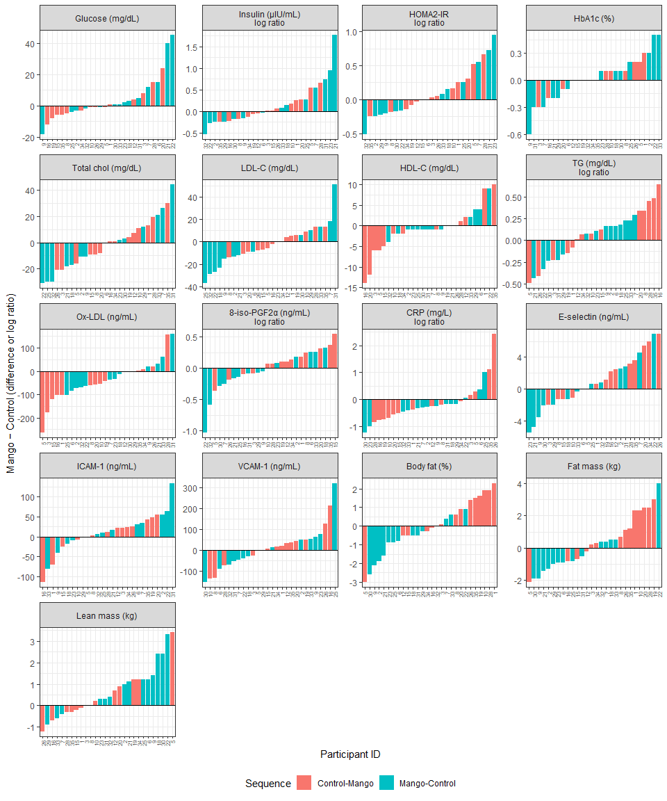

Mango-Cardio Study
================

## Dataset

- The Excel file `MANCAR_InBody_lab_10132026.xlsx` contains 231 rows
  from 31 distinct participant IDs (long format, one row per participant
  per visit). Variables include:
  - Participant data:
    - Status: `Finished` or `Dropped`
    - Treatment equence: Control-Mango or Mango-Control
    - Demographics: age and sex
    - Visit number (0-7) and date
    - Anthropometrics and body composition: height, weight, and InBody
      measurements
      - InBody measurements were taken at every visit
  - Biomarkers – see the list of outcomes below
    - Units are defined in
      `MANCAR_InBody_lab_data dictionary_10142026.xlsx`
    - Biomarkers were measured at visits 0 (baseline), 3 (end of phase
      1), and 7 (end of phase 2)
- Of the 31 participants:
  - 15 were randomized to the Control–Mango sequence and
  - 16 were randomized to the Mango–Control sequence
  - One participant in the control–mango sequence and two in the
    mango–control sequence withdrew, leaving 14 completers in each
    sequence
    - MANCAR24, Control-Mango, Last seen at Visit 0 (baseline)
    - MANCAR17, Mango-Control, Last seen at Visit 1
    - MANCAR27, Mango-Control, Last seen at Visit 3 (completed phase 1
      only)

## Outcomes

- There are 17 outcomes (10 primary and 7 secondary)

- Primary outcomes:

  - Glycemic indicators:
    - Fasting glucose (mg/dL)
    - Fasting insulin (µIU/mL)
    - HOMA2-IR (from Oxford calculator)
    - HgbA1c (%)
  - Lipids
    - Total cholesterol (mg/dL)
    - LDL-cholesterol (mg/dL)
    - HDL-cholesterol (mg/dL)
    - Triglycerides (mg/dL)
  - Oxidative stress
    - Oxidized LDL-C (ng/mL)
    - 8-iso-PGF2α (ng/mL)\*

- Secondary outcomes:

  - Inflammation markers:
    - C-reactive protein (mg/L)\*
    - E-selectin (ng/mL)\*
    - ICAM-1 (ng/mL)\*
    - VCAM-1 (ng/mL)\*
  - Body composition
    - Percent body fat (%)
    - Body fat mass (kg)
    - Lean body mass (kg)

\* Converted from the units in the raw data (pg/mL, or ng/mL
for CRP) by dividing by 1,000.

## Exploratory analysis

### Anomalies

- The plot below shows visit number against visit date for each
  participant
  - Visits were approximately evenly spaced. The earliest visit was in
    October 2024 and the latest in February 2026
  - One participant (MANCAR28) has visit dates that are out of order
    relative to visit number:

<!-- -->

- Visit dates for MANCAR28 are out of order:
  - Visits 0 and 1 are dated Jan–Feb 2026, while visits 2–7 run from Jul
    to Dec 2025.
  - The dates appear correct, but the visit numbers seem to be shifted
    by two?
    - i.e., labeled visits 2–7 are actually visits 0–5, and labeled
      visits 0–1 are actually visits 6–7?
  - To be confirmed with the study team

| partid   | seq           | visit | trt      | date       |
|:---------|:--------------|------:|:---------|:-----------|
| MANCAR28 | Control-Mango |     0 | Baseline | 2026-01-07 |
| MANCAR28 | Control-Mango |     1 | Control  | 2026-02-04 |
| MANCAR28 | Control-Mango |     2 | Control  | 2025-07-02 |
| MANCAR28 | Control-Mango |     3 | Control  | 2025-08-06 |
| MANCAR28 | Control-Mango |     4 | Mango    | 2025-08-28 |
| MANCAR28 | Control-Mango |     5 | Mango    | 2025-10-02 |
| MANCAR28 | Control-Mango |     6 | Mango    | 2025-11-05 |
| MANCAR28 | Control-Mango |     7 | Mango    | 2025-12-03 |

### Distribution

- Histograms of all outcomes, pooled across visits 0, 3, and 7, are
  shown below:
  - Some of the outcomes are right-skewed and need to be log-transformed

<!-- -->

### Profile plots

- Profile plots for glycemic indicators:
  - MANCAR24 (Control–Mango) had high glucose (139 mg/dL), HOMA2-IR
    (3.75), and HbA1c (6.8%) at baseline, and then dropped out.
  - MANCAR27 (Mango–Control) had high glucose at baseline (154 mg/dL)
    and at visit 3 (158 mg/dL), and then dropped out.
  - \[**Check needed**\] MANCAR21 (Mango–Control) had a spike in glucose
    (147 mg/dL) and insulin (119 µIU/mL) at visit 3, suggesting a
    non-fasting sample; HOMA2-IR was not calculated for this visit
    (insulin above the Oxford calculator’s upper limit)
  - \[**Check needed**\] MANCAR16 (Control–Mango) showed a steep decline
    in insulin (10.1 → 2.5 → 2.0 µIU/mL); HOMA2-IR is missing at visits
    3 and 7 because insulin was below the Oxford calculator’s lower
    limit.

<!-- -->

- Profile plots for lipids:
  - Lipid levels were generally stable within participants, particularly
    HDL-C; no consistent pattern by treatment phase is apparent
  - MANCAR10 (Control–Mango) had the highest total cholesterol (272–283
    mg/dL) and LDL-C (168–185 mg/dL) throughout, and the highest
    triglycerides at baseline (314 mg/dL).
  - \[**Check needed**\] MANCAR31 (Mango–Control) showed a large drop in
    total cholesterol (231 → 187 mg/dL) and LDL-C (172 → 121 mg/dL) from
    visit 3 to visit 7 (control phase)
  - \[**Check needed**\] MANCAR22 (Mango–Control) had a rise in total
    cholesterol (287 mg/dL), LDL-C (190 mg/dL), and triglycerides (235
    mg/dL) at visit 7 (control phase).
  - Three participants in the Mango–Control sequence had a dip in LDL-C
    at visit 3 (end of mango phase): MANCAR25 (115 → 81 → 118 mg/dL),
    MANCAR32 (113 → 79 → 108 mg/dL), and MANCAR23 (97 → 78 → 78 mg/dL).
  - MANCAR02 (Mango–Control) had consistently high HDL-C (76–85 mg/dL).
  - Dropouts: MANCAR24 (Control–Mango) had baseline values only (total
    cholesterol 249 mg/dL, LDL-C 159 mg/dL); MANCAR27 (Mango–Control)
    had high HDL-C (78 and 75 mg/dL) at baseline and visit 3.

<!-- -->

### Waterfall plots

- To be completed

<!-- -->

## Descriptive table at baseline

- To be completed

## Linear mixed models

- To be completed
