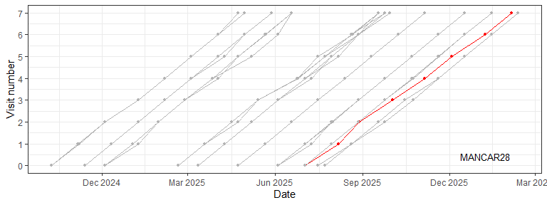
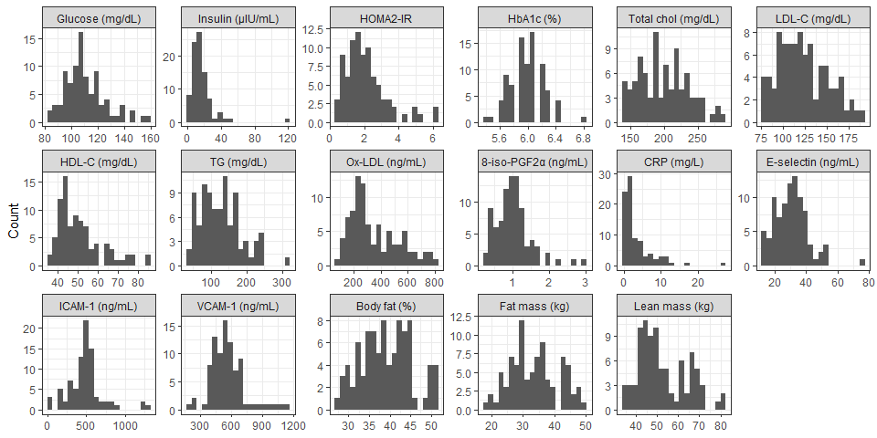
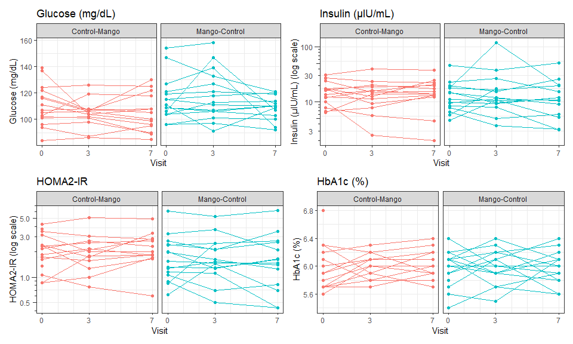
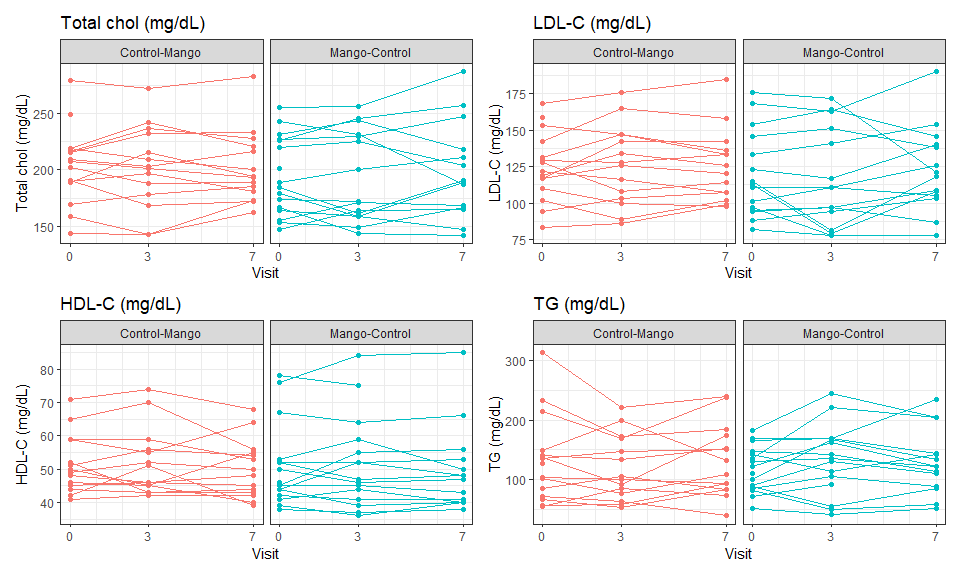
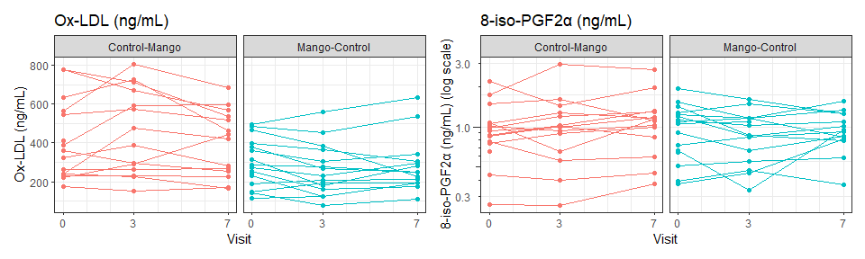
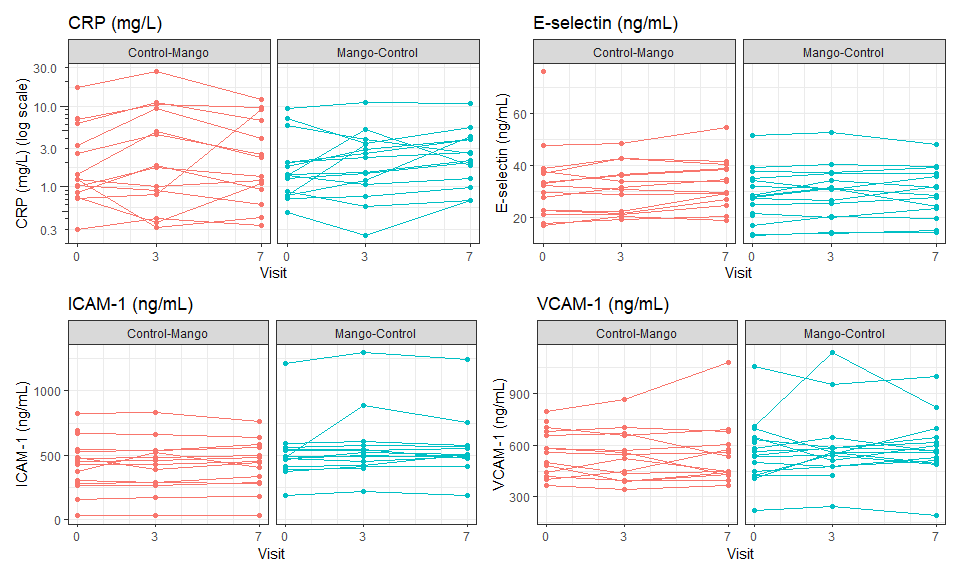
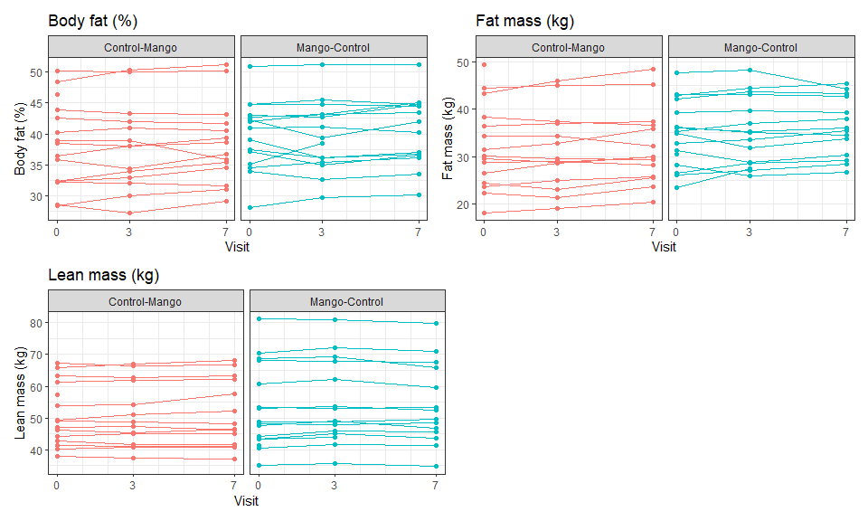
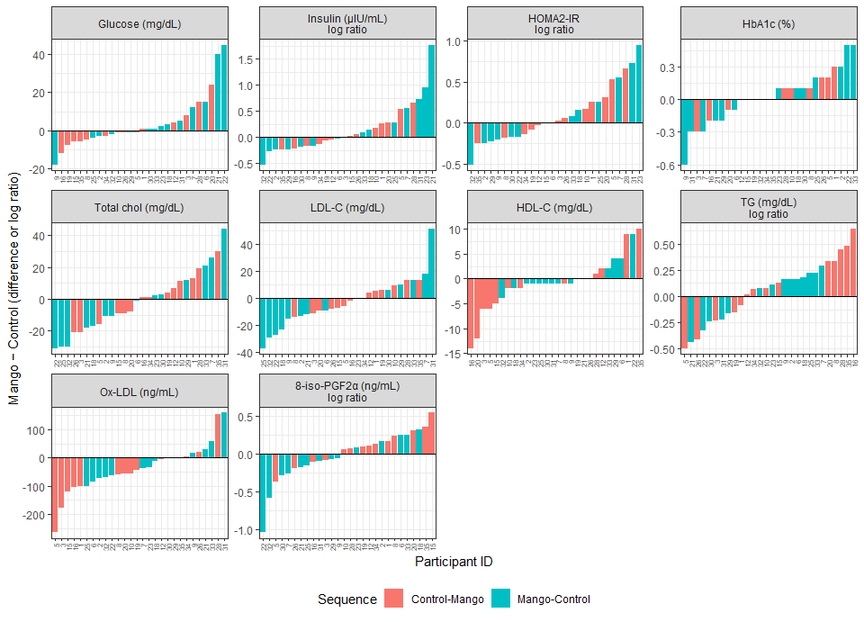
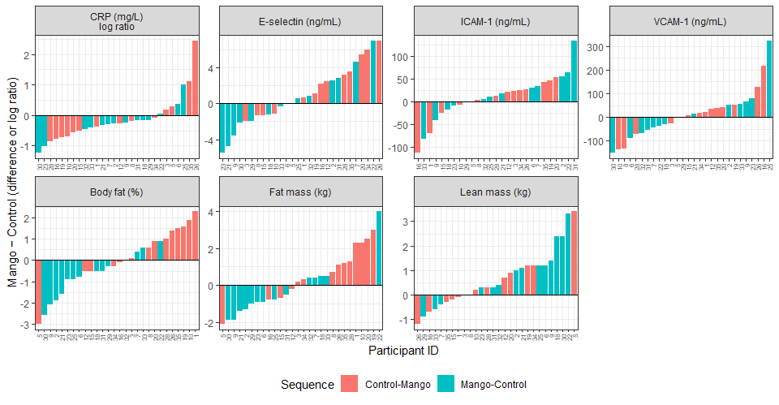

Mango-Cardio Study
================

## Dataset

- The Excel file `MANCAR_InBody_lab_10132026.xlsx` (later corrected in
  `MANCAR_InBody_lab_10302026.xlsx`) contains 231 rows from 31 distinct
  participant IDs (long format, one row per participant per visit).
  Variables include:
  - Participant data:
    - Status: `Finished` or `Dropped`
    - Treatment equence: Control-Mango or Mango-Control
    - Demographics: age and sex
    - Visit number (0-7) and date
    - Anthropometrics and body composition: height, weight, and InBody
      measurements
      - InBody measurements were taken at every visit
  - Biomarkers – see the list of outcomes below
    - Units are defined in
      `MANCAR_InBody_lab_data dictionary_10142026.xlsx`
    - Biomarkers were measured at visits 0 (baseline), 3 (end of phase
      1), and 7 (end of phase 2)
- Of the 31 participants:
  - 15 were randomized to the Control–Mango sequence and
  - 16 were randomized to the Mango–Control sequence
  - One participant in the control–mango sequence and two in the
    mango–control sequence withdrew, leaving 14 completers in each
    sequence
    - MANCAR24, Control-Mango, Last seen at Visit 0 (baseline)
    - MANCAR17, Mango-Control, Last seen at Visit 1
    - MANCAR27, Mango-Control, Last seen at Visit 3 (completed phase 1
      only)

## Outcomes

- There are 17 outcomes (10 primary and 7 secondary)

- Primary outcomes:

  - Glycemic indicators:
    - Fasting glucose (mg/dL)
    - Fasting insulin (µIU/mL)
    - HOMA2-IR (from Oxford calculator)
    - HgbA1c (%)
  - Lipids
    - Total cholesterol (mg/dL)
    - LDL-cholesterol (mg/dL)
    - HDL-cholesterol (mg/dL)
    - Triglycerides (mg/dL)
  - Oxidative stress
    - Oxidized LDL-C (ng/mL)
    - 8-iso-PGF2α (ng/mL)\*

- Secondary outcomes:

  - Inflammation markers:
    - C-reactive protein (mg/L)\*
    - E-selectin (ng/mL)\*
    - ICAM-1 (ng/mL)\*
    - VCAM-1 (ng/mL)\*
  - Body composition
    - Percent body fat (%)
    - Body fat mass (kg)
    - Lean body mass (kg)

\* Converted from the units in the raw data (pg/mL, or ng/mL
for CRP) by dividing by 1,000.

## Exploratory analysis

### Anomalies

- \[**Resolved**\] The following issue has been resolved with the
  corrected data: `MANCAR_InBody_lab_10302026.xlsx`
- The plot below shows visit number against visit date for each
  participant
  - Visits were approximately evenly spaced. The earliest visit was in
    October 2024 and the latest in February 2026
  - ~~One participant (MANCAR28) has visit dates that are out of order
    relative to visit number:~~

<!-- -->

- ~~Visit dates for MANCAR28 are out of order:~~
  - ~~Visits 0 and 1 are dated Jan–Feb 2026, while visits 2–7 run from
    Jul to Dec 2025.~~
  - ~~The dates appear correct, but the visit numbers seem to be shifted
    by two?~~
    - ~~i.e., labeled visits 2–7 are actually visits 0–5, and labeled
      visits 0–1 are actually visits 6–7?~~
  - ~~To be confirmed with the study team~~

### Distribution

- Histograms of all outcomes, pooled across visits 0, 3, and 7, are
  shown below:
  - Some of the outcomes are right-skewed and need to be log-transformed
  - The largest outlier in insulin was observed in MANCAR21 at visit 3
    (insulin 119 µIU/mL, glucose 147 mg/dL). HOMA2-IR was not calculated
    with this insulin value (above the Oxford calculator’s upper limit)

<!-- -->

### Profile plots

- See the [interactive profile
  plots](https://keijioda.github.io/mango_cardio/profile_plots.html) for
  all outcomes (hover over a line to see a participant’s values).

#### Profile plots for glycemic indicators:

- Dropouts:
  - MANCAR24 (Control–Mango) had high glucose (139 mg/dL), HOMA2-IR
    (3.75), and HbA1c (6.8%) at baseline, and then dropped out.
  - MANCAR27 (Mango–Control) had high glucose at baseline (154 mg/dL)
    and at visit 3 (158 mg/dL), and then dropped out.
- \[**Check needed**\] MANCAR21 (Mango–Control) had a spike in glucose
  (147 mg/dL) and insulin (119 µIU/mL) at visit 3, suggesting a
  non-fasting sample
  - HOMA2-IR was not calculated for this visit (insulin above the Oxford
    calculator’s upper limit)
  - \[**Checked**\] According to the Research Team, the subject’s kcal
    intake was very low the day prior, which might have lead to rebound
    hyperglycemia
- \[**Check needed**\] MANCAR22 (Mango–Control) had the largest drop in
  glucose from Mango to Control (139 → 94 mg/dL)
  - Insulin was consistently high at all visits (38.4–50.7 µIU/mL)
  - \[**Checked**\] According to the Research Team, the subject
    experienced ~7 kg weight loss during the second phase; See the
    change in fat mass also
- \[**Check needed**\] MANCAR16 (Control–Mango) showed a steep decline
  in insulin (10.1 → 2.5 → 2.0 µIU/mL)
  - HOMA2-IR is missing at visits 3 and 7 because insulin was below the
    Oxford calculator’s lower limit

<!-- -->

#### Profile plots for lipids:

- Lipid levels were generally stable within participants, particularly
  HDL-C

  - No consistent pattern by treatment phase is apparent

- Dropouts:

  - MANCAR24 (Control–Mango) had high lipid values at baseline (TC 249,
    LDL 159, HDL 65) before dropping out
  - MANCAR27 (Mango–Control) had high HDL-C (78 and 75 mg/dL) at
    baseline and visit 3

- MANCAR10 (Control–Mango) had the highest TC (272–283 mg/dL) and LDL
  (168–185 mg/dL) throughout, and the highest triglycerides at baseline
  (314 mg/dL)

- \[**Check needed**\] MANCAR31 (Mango–Control) showed a large drop in
  TC (231 → 187 mg/dL) and LDL (172 → 121 mg/dL) from visit 3 to visit 7
  (control phase)

- \[**Check needed**\] MANCAR22 (Mango–Control) had a rise in TC (287
  mg/dL), LDL (190 mg/dL), and TG (235 mg/dL) at visit 7 (control phase)

<!-- -->

#### Profile plots for oxidative markers:

- Oxidized LDL showed a pattern consistent with a mango effect: values
  decreased during the mango phase and increased during the control
  phase in both sequences
  - Oxidized LDL levels were generally higher in the Control–Mango
    sequence
  - 8-iso-PGF2α showed no consistent pattern by treatment phase
- MANCAR31 (Mango–Control) had a marked decrease in oxidized LDL during
  the control phase (384 → 224 ng/mL), in parallel with the drop in LDL
  noted above

<!-- -->

#### Profile plots for inflammatory markers:

- \[**Check needed**\] CRP:
  - MANCAR26 (Control–Mango) had a spike at visit 7 (0.80 → 9.12 mg/L),
    suggesting an acute inflammatory episode
- E-selectin:
  - MANCAR24 (Control–Mango) had a high value at baseline (75.9 ng/mL)
    before dropping out
- ICAM-1:
  - MANCAR02 (Mango–Control) had consistently high values (1,211–1,298
    ng/mL)
  - MANCAR05 (Control–Mango) consistently low values (~28 ng/mL)
  - MANCAR31 (Mango–Control) increased from 484 to 885 ng/mL at visit 3
    (mango phase)
- \[**Check needed**\] VCAM-1:
  - MANCAR16 (Control–Mango) increased steadily (795 → 865 → 1,080
    ng/mL)
  - MANCAR25 (Mango–Control) had a spike at visit 3 (1,140 ng/mL)
  - MANCAR33 (Mango–Control) had consistently low values (189–243 ng/mL)

<!-- -->

#### Profile plots for body composition:

- Body fat:
  - MANCAR27 (Mango–Control) increased during the mango phase (35.2% →
    38.5%) before dropping out
- Fat mass:
  - MANCAR22 (Mango–Control) decreased during the control phase (48.3 →
    44.3 kg)
  - MANCAR27 (Mango–Control) increased during the mango phase (23.5 →
    27.5 kg) before dropping out
- Lean mass: Very stable within participants

<!-- -->

### Waterfall plots

- Each bar shows the within-participant difference between the end of
  the mango phase and the end of the control phase (mango − control) for
  completers. For skewed outcomes (insulin, HOMA2-IR, triglycerides,
  8-iso-PGF2α, and CRP), the log ratio, log(mango / control), is shown.
  Bars are colored by treatment sequence.

<!-- -->

- Glycemic indicators:
  - Glucose, insulin, HOMA2-IR, and HbA1c showed no consistent
    direction; participants were split roughly evenly between lower and
    higher values on mango (e.g., glucose 14 vs 14)
  - The largest positive glucose differences came from:
    - MANCAR22 (139 vs 94 mg/dL), whose glucose dropped during the
      control phase, and
    - MANCAR21 (147 vs 107 mg/dL), whose end-of-mango sample was likely
      non-fasting (see “Profile plots for glycemic indicators” section
      above)
    - The largest insulin difference was also from MANCAR21
- Lipids:
  - TC was evenly split (14 vs 14)
  - LDL tended to be slightly lower on mango (15 lower, 11 higher)
    - The largest positive difference (+51 mg/dL) was from MANCAR31,
      whose LDL-C dropped during the control phase (see “Profile plots
      for lipids” section above)
  - HDL tended to be slightly lower on mango (17 lower, 8 higher)
  - TG tended to be higher on mango in 18 of 28 participants
- Oxidative stress:
  - Oxidized LDL was lower on mango in 20 of 28 participants
  - 8-iso-PGF2α showed no consistent direction

<!-- -->

- Inflammatory markers:
  - CRP was lower on mango in 21 of 28 participants
    - The largest positive difference in CRP was MANCAR26, with a spike
      at the end of the mango phase (see “Profile plots for
      inflammatory” section above)
- Body composition:
  - Body fat (%) and fat mass were evenly split overall, but bars were
    largely separated by sequence:
    - Control–Mango participants mostly had positive differences and
    - Mango–Control participants mostly negative
    - These are consistent with an increase in phase 2 regardless of
      diet (period effect)
  - Lean mass tended to be higher on mango (17 of 28)

## Descriptive table at baseline

- Participant characteristics at baseline, by treatment sequence:
  - For highly right-skewed outcomes (insulin, HOMA2-IR, 8-iso-PGF2α,
    and CRP), the median (Q1, Q3) is shown instead of the mean (SD).
  - The baseline table includes all randomized participants (n = 31); 2
    withdrew before the end of phase 1 and 1 after phase 1

<table class="gt_table" data-quarto-disable-processing="false" data-quarto-bootstrap="false">
  <thead>
    <tr class="gt_col_headings gt_spanner_row">
      <th class="gt_col_heading gt_columns_bottom_border gt_left" rowspan="2" colspan="1" scope="col" id="label"><strong>Characteristic</strong></th>
      <th class="gt_col_heading gt_columns_bottom_border gt_center" rowspan="2" colspan="1" scope="col" id="stat_0"><strong>Overall</strong> 
N = 311</th>
      <th class="gt_center gt_columns_top_border gt_column_spanner_outer" rowspan="1" colspan="2" scope="colgroup" id="level-1;-stat_1">
        
<strong>Treatment sequence</strong>

      </th>
    </tr>
    <tr class="gt_col_headings">
      <th class="gt_col_heading gt_columns_bottom_border gt_center" rowspan="1" colspan="1" scope="col" id="stat_1"><strong>Control-Mango</strong> 
N = 151</th>
      <th class="gt_col_heading gt_columns_bottom_border gt_center" rowspan="1" colspan="1" scope="col" id="stat_2"><strong>Mango-Control</strong> 
N = 161</th>
    </tr>
  </thead>
  <tbody class="gt_table_body">
    <tr><td headers="label" class="gt_row gt_left" style="font-weight: bold;">Sex</td>
<td headers="stat_0" class="gt_row gt_center"> </td>
<td headers="stat_1" class="gt_row gt_center"> </td>
<td headers="stat_2" class="gt_row gt_center"> </td></tr>
    <tr><td headers="label" class="gt_row gt_left">    Female</td>
<td headers="stat_0" class="gt_row gt_center">22 (71%)</td>
<td headers="stat_1" class="gt_row gt_center">10 (67%)</td>
<td headers="stat_2" class="gt_row gt_center">12 (75%)</td></tr>
    <tr><td headers="label" class="gt_row gt_left">    Male</td>
<td headers="stat_0" class="gt_row gt_center">9 (29%)</td>
<td headers="stat_1" class="gt_row gt_center">5 (33%)</td>
<td headers="stat_2" class="gt_row gt_center">4 (25%)</td></tr>
    <tr><td headers="label" class="gt_row gt_left" style="font-weight: bold;">Age</td>
<td headers="stat_0" class="gt_row gt_center">51.8 (6.7)</td>
<td headers="stat_1" class="gt_row gt_center">51.9 (5.6)</td>
<td headers="stat_2" class="gt_row gt_center">51.7 (7.7)</td></tr>
    <tr><td headers="label" class="gt_row gt_left" style="font-weight: bold;">BMI (kg/m²)</td>
<td headers="stat_0" class="gt_row gt_center">31.1 (3.6)</td>
<td headers="stat_1" class="gt_row gt_center">31.2 (4.1)</td>
<td headers="stat_2" class="gt_row gt_center">30.9 (3.3)</td></tr>
    <tr><td headers="label" class="gt_row gt_left" style="font-weight: bold;">Fasting glucose (mg/dL)</td>
<td headers="stat_0" class="gt_row gt_center">112.5 (16.0)</td>
<td headers="stat_1" class="gt_row gt_center">110.5 (15.5)</td>
<td headers="stat_2" class="gt_row gt_center">114.3 (16.8)</td></tr>
    <tr><td headers="label" class="gt_row gt_left" style="font-weight: bold;">Fasting insulin (µIU/mL)</td>
<td headers="stat_0" class="gt_row gt_center">14.7 (8.4, 18.6)</td>
<td headers="stat_1" class="gt_row gt_center">16.4 (10.1, 24.3)</td>
<td headers="stat_2" class="gt_row gt_center">13.0 (8.1, 18.3)</td></tr>
    <tr><td headers="label" class="gt_row gt_left" style="font-weight: bold;">HOMA2-IR</td>
<td headers="stat_0" class="gt_row gt_center">1.98 (1.16, 2.42)</td>
<td headers="stat_1" class="gt_row gt_center">2.19 (1.35, 3.15)</td>
<td headers="stat_2" class="gt_row gt_center">1.77 (1.12, 2.41)</td></tr>
    <tr><td headers="label" class="gt_row gt_left" style="font-weight: bold;">HgbA1c (%)</td>
<td headers="stat_0" class="gt_row gt_center">5.98 (0.28)</td>
<td headers="stat_1" class="gt_row gt_center">5.97 (0.32)</td>
<td headers="stat_2" class="gt_row gt_center">5.98 (0.26)</td></tr>
    <tr><td headers="label" class="gt_row gt_left" style="font-weight: bold;">Total cholesterol (mg/dL)</td>
<td headers="stat_0" class="gt_row gt_center">199.1 (34.0)</td>
<td headers="stat_1" class="gt_row gt_center">203.8 (33.6)</td>
<td headers="stat_2" class="gt_row gt_center">194.7 (34.7)</td></tr>
    <tr><td headers="label" class="gt_row gt_left" style="font-weight: bold;">LDL-cholesterol (mg/dL)</td>
<td headers="stat_0" class="gt_row gt_center">122.7 (26.1)</td>
<td headers="stat_1" class="gt_row gt_center">124.9 (23.6)</td>
<td headers="stat_2" class="gt_row gt_center">120.6 (28.8)</td></tr>
    <tr><td headers="label" class="gt_row gt_left" style="font-weight: bold;">HDL-cholesterol (mg/dL)</td>
<td headers="stat_0" class="gt_row gt_center">51.6 (10.8)</td>
<td headers="stat_1" class="gt_row gt_center">52.5 (9.2)</td>
<td headers="stat_2" class="gt_row gt_center">50.8 (12.4)</td></tr>
    <tr><td headers="label" class="gt_row gt_left" style="font-weight: bold;">Triglycerides (mg/dL)</td>
<td headers="stat_0" class="gt_row gt_center">124.9 (57.1)</td>
<td headers="stat_1" class="gt_row gt_center">132.7 (72.7)</td>
<td headers="stat_2" class="gt_row gt_center">117.6 (38.2)</td></tr>
    <tr><td headers="label" class="gt_row gt_left" style="font-weight: bold;">Oxidized LDL-C (ng/mL)</td>
<td headers="stat_0" class="gt_row gt_center">351.7 (173.0)</td>
<td headers="stat_1" class="gt_row gt_center">409.5 (203.1)</td>
<td headers="stat_2" class="gt_row gt_center">297.6 (122.2)</td></tr>
    <tr><td headers="label" class="gt_row gt_left" style="font-weight: bold;">8-iso-PGF2α (ng/mL)</td>
<td headers="stat_0" class="gt_row gt_center">0.98 (0.66, 1.23)</td>
<td headers="stat_1" class="gt_row gt_center">0.93 (0.75, 1.07)</td>
<td headers="stat_2" class="gt_row gt_center">1.07 (0.65, 1.25)</td></tr>
    <tr><td headers="label" class="gt_row gt_left" style="font-weight: bold;">C-reactive protein (mg/L)</td>
<td headers="stat_0" class="gt_row gt_center">1.39 (0.79, 3.29)</td>
<td headers="stat_1" class="gt_row gt_center">1.24 (0.86, 6.08)</td>
<td headers="stat_2" class="gt_row gt_center">1.39 (0.79, 2.03)</td></tr>
    <tr><td headers="label" class="gt_row gt_left" style="font-weight: bold;">E-selectin (ng/mL)</td>
<td headers="stat_0" class="gt_row gt_center">30.5 (12.5)</td>
<td headers="stat_1" class="gt_row gt_center">32.9 (14.7)</td>
<td headers="stat_2" class="gt_row gt_center">28.2 (10.1)</td></tr>
    <tr><td headers="label" class="gt_row gt_left" style="font-weight: bold;">ICAM-1 (ng/mL)2</td>
<td headers="stat_0" class="gt_row gt_center">473.2 (213.2)</td>
<td headers="stat_1" class="gt_row gt_center">433.8 (209.8)</td>
<td headers="stat_2" class="gt_row gt_center">512.6 (216.3)</td></tr>
    <tr><td headers="label" class="gt_row gt_left" style="font-weight: bold;">VCAM-1 (ng/mL)</td>
<td headers="stat_0" class="gt_row gt_center">561.3 (157.7)</td>
<td headers="stat_1" class="gt_row gt_center">559.8 (132.1)</td>
<td headers="stat_2" class="gt_row gt_center">562.6 (182.8)</td></tr>
    <tr><td headers="label" class="gt_row gt_left" style="font-weight: bold;">Percent body fat (%)</td>
<td headers="stat_0" class="gt_row gt_center">39.2 (6.1)</td>
<td headers="stat_1" class="gt_row gt_center">38.3 (6.9)</td>
<td headers="stat_2" class="gt_row gt_center">39.9 (5.4)</td></tr>
    <tr><td headers="label" class="gt_row gt_left" style="font-weight: bold;">Body fat mass (kg)</td>
<td headers="stat_0" class="gt_row gt_center">33.5 (7.9)</td>
<td headers="stat_1" class="gt_row gt_center">32.1 (8.9)</td>
<td headers="stat_2" class="gt_row gt_center">34.8 (6.9)</td></tr>
    <tr><td headers="label" class="gt_row gt_left" style="font-weight: bold;">Lean body mass (kg)</td>
<td headers="stat_0" class="gt_row gt_center">52.1 (11.4)</td>
<td headers="stat_1" class="gt_row gt_center">51.1 (9.7)</td>
<td headers="stat_2" class="gt_row gt_center">53.0 (13.1)</td></tr>
  </tbody>
  <tfoot>
    <tr class="gt_footnotes">
      <td class="gt_footnote" colspan="4">1 n (%); Mean (SD); Median (Q1, Q3)</td>
    </tr>
    <tr class="gt_footnotes">
      <td class="gt_footnote" colspan="4">2 ICAM-1 missing for 1 participant (above assay range); n = 30 (15 per sequence).</td>
    </tr>
  </tfoot>
</table>

## Linear mixed models

### Model descriptions

- A separate linear mixed model was fitted for each outcome:

  - Fixed effects: treatment (mango vs. control), sequence, phase, and
    the baseline value of the outcome
  - Random effect: a random intercept for each participant

- Skewed outcomes (insulin, HOMA2-IR, triglycerides, 8-iso-PGF2α, and
  CRP) were analyzed on the log scale.

- Estimated marginal (adjusted) means for each treatment and the
  treatment difference (mango − control), with 95% confidence intervals,
  were obtained from each model using Kenward–Roger degrees of freedom.

  - For log-transformed outcomes, estimates were back-transformed and
    are presented as geometric means and the ratio of geometric means
    (mango / control).
